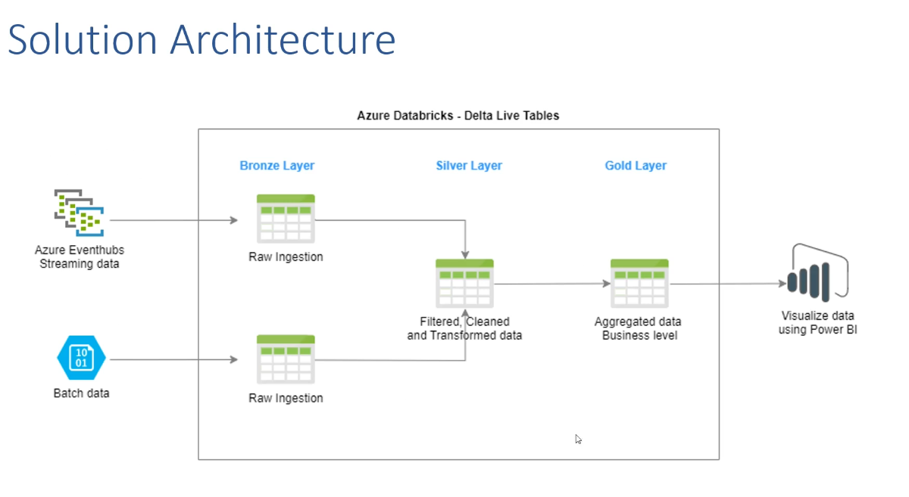

# Airline Data Pipeline: Azure Event Hubs + Databricks Declarative Pipelines (Delta Live Tables)

A batch + streaming data pipeline on Azure Databricks using the medallion (Bronze / Silver / Gold) pattern.
US airline on-time performance data arrives two ways: as batch files in Azure Blob Storage and as a live
event stream through Azure Event Hubs. Both land in Unity Catalog and are combined with Lakeflow Spark
Declarative Pipelines (formerly Delta Live Tables).



## Dataset

US airline on-time performance (`ONTIME_REPORTING_*.csv`, 5 files in [`data/`](data/)). One row is one flight, with 32 columns:

| Group | Columns |
|---|---|
| Date | `MONTH`, `DAY_OF_MONTH`, `DAY_OF_WEEK` |
| Flight | `OP_UNIQUE_CARRIER`, `TAIL_NUM`, `OP_CARRIER_FL_NUM` |
| Route | `ORIGIN`, `ORIGIN_CITY_NAME`, `DEST`, `DEST_CITY_NAME` (and airport IDs) |
| Timing | `CRS_DEP_TIME`, `DEP_TIME`, `CRS_ARR_TIME`, `ARR_TIME`, time blocks |
| Delays | `DEP_DELAY_NEW`, `ARR_DELAY_NEW`, `CARRIER_DELAY`, `WEATHER_DELAY`, `NAS_DELAY`, `SECURITY_DELAY`, `LATE_AIRCRAFT_DELAY` |
| Status / distance | `CANCELLED`, `CANCELLATION_CODE`, `DISTANCE`, `DISTANCE_GROUP`, elapsed times |

## How it works

```
Batch:   CSV files -> Azure Blob Storage -> notebook 1 -> Delta table  airline_cluster.airline.airlinereporting
Stream:  CSV -> producer script -> Azure Event Hubs -> notebook 2 -> CSV files in a Unity Catalog Volume
                                                                        |
Pipeline (sql/3.dlt-batch-streaming.sql):                               v
  airline22_bronze (Auto Loader) -> airline22_silver (clean + expectations)
  airline33_bronze (batch table) --+
  airline22_bronze ----------------+-> airline33_silver (stream + batch join) -> airline33_cleaned (APPLY CHANGES)
```

| Step | File | What it does |
|---|---|---|
| 1 | [`notebooks/1.Import_airlinedata_from_Blob_Storage.ipynb`](notebooks/1.Import_airlinedata_from_Blob_Storage.ipynb) | Reads all CSVs in the Blob container into one DataFrame and saves it as the Delta table `airlinereporting`. |
| 2 | [`producer/airline_streaming_event.py`](producer/airline_streaming_event.py) | Simulates live flights: reads a CSV row by row and sends each row as a JSON event to Event Hubs. |
| 3 | [`notebooks/2.dlt-stream-eventhub-data-pyth.ipynb`](notebooks/2.dlt-stream-eventhub-data-pyth.ipynb) | Reads Event Hubs through its Kafka endpoint, parses the JSON with an explicit schema, and writes CSV files to `/Volumes/airline_cluster/airline/raw/airline22`. |
| 4 | [`sql/3.dlt-batch-streaming.sql`](sql/3.dlt-batch-streaming.sql) | The declarative pipeline: five tables from Bronze to a cleaned Silver table. |
| - | [`terraform/`](terraform/) | Azure infrastructure: storage account, Event Hubs namespace and hub, Databricks workspace. |

### Pipeline tables

| Table | Type | Purpose |
|---|---|---|
| `airline22_bronze` | Streaming table | Raw stream data, ingested incrementally from the Volume with `read_files` (Auto Loader). |
| `airline22_silver` | Streaming table | Renamed columns, casts, and data-quality expectations (`DROP ROW` on null `TAIL_NUM` or non-positive day). |
| `airline33_bronze` | Materialized view | The batch table `airlinereporting`. |
| `airline33_silver` | Streaming table | Stream-static join of the streaming bronze table with the batch table. |
| `airline33_cleaned` | Streaming table | `APPLY CHANGES` (CDC): upserts by key and deletes cancelled flights. |

## Design notes

- **Kafka endpoint for Event Hubs.** The cluster runs Databricks Runtime 18 LTS (Spark 4.1, Scala 2.13). The `azure-eventhubs-spark` connector targets Scala 2.12, so notebook 2 uses Spark's built-in Kafka source against the Event Hubs Kafka endpoint (port 9093). No extra library is needed.
- **Unity Catalog only.** Managed tables must be Delta, checkpoints and landing files live in Volumes, and nothing uses DBFS or `hive_metastore`.
- **`availableNow` trigger.** Notebook 2 processes whatever is in the event hub and stops. Schedule it as a Job, or switch to `processingTime` for continuous runs. Event Hubs retention in this setup is 1 hour.
- **Explicit checkpoints.** This workspace rejects implicit temporary checkpoints, so every streaming `display()` and `writeStream` sets one.

## Known limitations

- There is no Gold layer or Power BI report yet. The diagram shows the target design.
- `airline33_silver` joins on `(DAY_OF_MONTH, DAY_OF_WEEK, TAIL_NUM)`, so one stream row can match several batch rows. A union of the two sources, or a join key with the full date and flight number, would be a better design.
- `APPLY CHANGES` sequences by `OP_UNIQUE_CARRIER`, which is a carrier code and not a timestamp. A real sequence column would give a correct "latest row".

## Running it

1. Provision infrastructure with the files in [`terraform/`](terraform/) (fill in your subscription and tenant IDs), or create the resources by hand.
2. Upload the CSVs from `data/` to your Blob container, then run notebook 1. Put the storage key in a Databricks secret scope instead of the notebook.
3. Copy `.env.example` to `.env`, fill in your Event Hubs connection string, and run the producer:
   ```bash
   pip install azure-eventhub
   export EVENTHUB_CONN_STR="..."   # PowerShell: $env:EVENTHUB_CONN_STR = "..."
   python producer/airline_streaming_event.py
   ```
4. Run notebook 2 (skip the optional streaming `display` cells) to land the CSVs in the Volume.
5. Create an ETL pipeline from `sql/3.dlt-batch-streaming.sql` with catalog `airline_cluster` and a target schema, and start it.

## Secrets

Credentials are not stored in this repo. Placeholders such as `<YOUR_STORAGE_ACCOUNT_KEY>` and `<YOUR_EVENT_HUB_KEY>`
mark where to supply them. `.env` is git-ignored.
